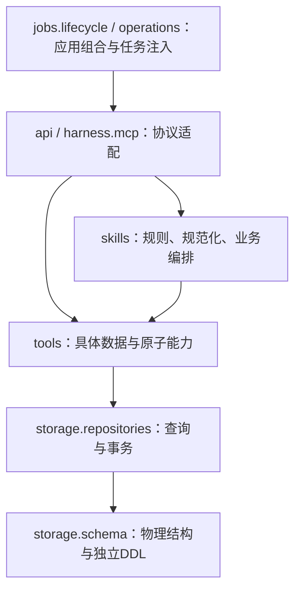

# 模块边界与渐进重构方案

> 更新2026-11-18；模块化单体渐进重构，剩余存储访问债务逐项迁移。

## 一、系统设计

当前后端结构（2026-11-18）：

core提供配置、日志与JSON解析；应用启停不再放在core，HTTP通过操作接口使用后台任务。
图示为当前契约；剩余1项CLI模型注入依赖逐项保留在基线，不以间接导入或整目录豁免隐藏。

保留模块化单体及现有 `api → harness/skills → tools → storage` 契约，core 提供通用设施。
优化目标是让职责与依赖清晰，不以文件数量减少为目标，也不为个人平台引入微服务、消息中间件或额外数据库。

2026-11-18进一步收敛：账户服务归 `tools/auth/users.py`，core.security仅负责密码与JWT；
研报和行业分析全部通过tools读取/保存，SQL分别归 `storage/repositories/report_analysis.py` 与 `industry_data.py`。
历史依赖基线5→1，保留年报修复CLI的模型工厂注入例外，没有扩大豁免。

## 二、需求优化

2026-11-17全仓检查覆盖380个已跟踪Python/JS/JSX文件（297个生产文件），基线672项Python测试通过。
本轮聚焦功能与接口保持下的首屏加载、阻塞IO、并发初始化、仓储边界、重复请求和行情计算；
保留既有研究结论、冻结参数、交易信号与历史快照。文件按职责拆分，避免仅以行数或合并数量衡量整洁。

新增指数成分股池、5/15/30/60 分钟行情、新闻快照前，先稳定数据访问边界。
领域编排继续归 skills；采集调度归 jobs；外部数据接口归 tools；所有 SQL 与连接归 storage。
MCP 与 HTTP 只做协议、校验、鉴权和结果转换，不能成为另一套查询实现。

## 三、问题

| 本轮问题 | 根因 | 处理 |
|---|---|---|
| 模型分析长时间持有PG连接 | 读取、LLM调用、写入包在同一with里 | 先读后释放，模型调用无数据库会话，最后短事务原子保存 |
| 研报预测残留、后台工作偶发看不到新结果 | 空预测不清旧行；翻译/链提取在提交前启动 | 预测整组替换，写入完成提交后启动续接 |
| OCR/失败报告被统计为提取成功 | 批量使用选中行数而不是实际成功数 | processed/failed/queued_ocr/discarded分开统计，修正调用方日志 |
| 临时JWT密钥每次签验都变化 | 缺AUTH_SECRET时每次重新随机 | 一进程一密钥，并发初始化加锁，配置密钥优先 |
| 页面轮询逻辑重复且有请求交叠风险 | 各页分别维护定时器、可见性和中断 | 行情/日志共享串行polling，离页取消，隐藏行情页暂停 |
| 应用异常退出跳过清理、停用任务在关闭时仍被实例化 | yield缺finally，各调度器重复启停 | 统一已启动调度器列表与finally清理，逐个停止互不阻断 |
| 占位路由与自检脚本留在运行目录 | 旧对话入口未删除，手工mock没有纳入测试 | 删除只回todo的/agent/chat；脚本转成自动测试；crawl/status读取真实观测 |
| PDF和JSON实现重复 | 年报模块复制通用提取链，两个领域复制围栏清洗 | 复用tools.pdf.text/core.json_response |

| 第二轮问题 | 根因 | 处理 |
|---|---|---|
| MCP混合协议、SQL与业务计算 | 20个数据库会话散落在适配器中 | 全部下沉仓储，工具层提供具体数据操作；Alpha计算独立为纯函数 |
| 两套向量集合重复维护生命周期 | 领域模块各自创建、重建、删除 | 共用ChunkCollection，字段保留各自schema，首次创建加锁合并 |
| 多处模型JSON解析逐渐漂移 | 6处重复解码/代码围栏/对象提取 | 统一core.json_response，旧调用名及围栏处理差异保留 |
| 研报入口职责过多、OCR/扫描件重复回写 | 规范化、排队及正文SQL混在Skill中 | normalization、ocr、report_text分离，共用正文写入 |
| API知道调度器内部状态，core负责任务编排 | 缺少应用组合与操作接口 | 启动迁到jobs.lifecycle，API经依赖注入访问operations，调度器提供status |
| 拆分OCR时遗漏续跑门槛（回归发现） | SQL所在with内还包含正文与rowcount分支 | 仅替换存储调用并保留控制流，覆盖正常、空正文、失败、删除后停止 |
| MCP日志污染协议输出（集成发现） | 仓储提前导入后，logger提前绑定stdout | 协议保留独立输出流，现有/后续诊断均导向stderr，增加真实stdio验收 |

| 本轮发现 | 根因 | 处理与边界 |
|---|---|---|
| 登录/对话页加载全部业务及图表 | Platform静态导入所有页面，结果数据工具与绘图库耦合 | 页面与绘图按需加载；纯数据模块与React分开 |
| 研报/监控查询拖慢其他请求 | async路由内同步执行PG | 路由to_thread，工具门面与只读仓储分离 |
| 并发首次读取配置可能拿到半成品 | 提前标记initialized | 持锁完整初始化，成功后发布状态；失败可重试 |
| 并发日志初始化可能重复写入 | bucket检查和handler创建没有同步 | 进程锁保护，日志设置每进程读取一次 |
| 单行查询读取整个结果集 | fetch_one复用fetch_all | 使用cursor.fetchone，返回类型保持 |
| 快速搜索/切详情被旧结果覆盖 | 无取消，搜索setState后立即读取旧闭包 | AbortController与结果归属检查；搜索显式传当前关键词 |
| 多监控窗口同时击穿缓存 | 缓存检查/刷新无互斥，使用墙上时钟 | 10秒monotonic缓存及互斥合并，不缓存鉴权角色 |
| 采集失败时资源未关闭 | close仅在成功路径调用 | closing保证异常路径也释放资源 |

重构前静态统计（不含 tests）：`storage/pg_schema.py` 1322 行，`skills/report/skill.py` 765 行，
`harness/loop.py` 630 行，`harness/mcp/tools/financial.py` 582 行。
仅 harness/skills 中就有 16 个模块直接导入 storage；代码实态尚未满足声明的分层契约。

| 位置 | 具体问题 | 优先级 |
|---|---|---|
| API、Skill、MCP 工具中的 SQL | 同一数据存在多个读取入口，协议与数据访问混合 | P1 |
| `tools/market/sync_index.py` | DDL、供应商调用和业务 upsert 共处一个事务；不适合新增分钟任务照搬 | P1 |
| `storage/pg_schema.py` | 行情/财务/研报/视图/ensure 混合，新增域继续堆积 | P1 |
| `harness/loop.py` | 快车道、提示词、工具执行和循环混合，测试替换范围过大 | P2 |
| `api/finance.py` | 对话、数据字典、产业链生成/保存共用模块 | P2 |
| `web/src/` | 页面、请求、图表和样式平铺；index.css 862 行 | P2 |
| MCP 两套 server | 传输实现不同但共用 REGISTRY；不能因名称相近就强行合并 | P2 |
| 项目根pip/pytest临时目录 | 默认临时目录落在根目录，安装/测试结束后残留混入工作区 | P2 |

## 四、处理方案

2026-11-18用户授权整理未跟踪资料：`_migration_tmp/`仅含旧财务/指数补跑、三季报爬取与行情探测驱动、两份名单和截图，没有生产引用或运行中的脚本；`docs/plans/AI建设.md`为早期部署/算力预算草稿，有保留价值但不是当前实施依据。递归删除被工具策略拦截，改为可恢复移动至忽略目录`output/cleanup-archive/20261118-untracked/`，保留9份原件及SHA-256清单，移除源码区两个目录。规划原文不纳入Git，未验证其中旧价格/模型规格，也不把它当作现行采购建议。同步移除pytest与Ruff对已消失`_migration_tmp`的临时排除项；不改应用、数据库或调度器。

第二轮收敛后的职责：

- `harness/mcp/tools/`保留33个工具的参数、协议错误与结果适配，完全移除直接查库与SQL实现。
- `skills/beta_alpha/analysis/alpha_context.py`只做四象限计算；`tools/finance/data.py`提供数据，`storage/repositories/financial.py`持有查询与只读事务。
- `skills/report/normalization.py`统一字段处理，`ocr.py`负责队列与续接；OCR/扫描件/翻译共用`tools/finance/report_text.py`。
- 报告与年报向量schema归`storage/schema/vector_chunks.py`，生命周期归`storage/repositories/vector_chunks.py`，旧collection入口保留兼容。
- 产业链DDL归`storage/schema/industry.py`，独立连接执行；旧`skills.beta_alpha.schema`调用名兼容，传入业务连接也不会提交该连接。
- `jobs/lifecycle.py`是应用启动组合根，`jobs/operations.py`提供后台操作，API只依赖`api.deps`声明的接口；内部旧core.lifespan导入已更新。

保留策略、筛选口径、物理集合字段和现有HTTP/MCP协议；移除重复章节横幅、过时入口说明及搬迁后无效注释，保留事务、复权和数据口径说明。

本轮新增职责：`storage/repositories/reports.py`、`monitoring.py`集中查询；
`tools/finance/report_catalog.py`、`tools/monitoring.py`、`tools/zsxq/accounts.py`提供协议无关能力。
研报API与旧管理接口的分页、筛选、日期、翻译优先及原文下载契约保留；没有DDL或数据库改名。
API直连存储的5项导入已移除，基线逐项删减为45项，未新增豁免。

前端`lib/http.js`统一JSON/SSE/下载鉴权与错误处理，`platformApi.js`保留原调用出口；
`hooks/useSession.js`独立会话状态，`chat/resultData.js`负责格式/图形选择，
`chat/ResultLineChart.jsx`按需绘图，`components/FeatureBoundary.jsx`隔离页面加载失败。
pytest默认发现范围固定在项目测试目录，排除产物与依赖目录；一次性迁移资料统一归档到output，临时文件仍只放output/tmp。

行情计算预提取数组替代逐根Pandas索引、只迭代状态机需要的列、跳过已为数值类型的重复转换；
保留状态机条件、浮点运算顺序、原始执行价隔离和所有输出字段。

建议先按以下边界拆分；旧导入路径与 CLI 入口保留兼容门面，迁移调用方后再移除：

| 当前模块 | 目标职责 |
|---|---|
| `storage/pg_schema.py` | `storage/schema/` 按 market/financial/reports/auth/views 分组；旧模块重导出兼容符号 |
| 分散的查询 SQL | `storage/repositories/` 按市场、财务、研报、新闻提供仓储；优先迁移重复/高频查询 |
| `harness/loop.py` | 保留公共入口；提取 fast_lane、execution、prompts，保持 run_agent_stream 协议 |
| `skills/report/skill.py` | skill 负责领域入口，pipeline 编排抽取/OCR/入库续跑，retrieval 组织检索 |
| `api/finance.py` | chat/chains/schema 三个路由模块；聚合出口保持 URL 与鉴权不变 |
| `web/src/` | `features/chat`、`features/reports`、`features/market`、`features/news`，共用组件进 components，API/协议进 lib |

适合合并的是重复的代码职责：SSE 格式化、供应商限流重试、分页/水位线、数据库 upsert、向量集合生命周期。
通用代码只在至少两个真实调用点出现相同行为时提取，避免把领域差异塞进万能 utils。
调度器可共享时间/重试工具，但行情、研报与新闻管线分别保留；FastMCP 与 legacy server 保留协议差异，只共享工具定义和执行结果契约。
`skills/report/collection.py` 与 `skills/content/collection.py` 的存储行为迁往 storage，集合字段定义仍按领域独立。

顺序：仓储与 DDL 边界 → 研报/行情采集编排 → Agent 执行拆分 → 前端按功能迁移。
新增行情/新闻接入在新边界中实现，不等待全仓重构完成；方案见 [数据源选型](data_sources.md)。

2026-11-13工作区整理：核验21个`pip-*`目录均为旧安装的空目录、元数据或wheel，
运行依赖从虚拟环境/已配置site-packages加载，sys.path不含这些残留。
删除操作被自动审批策略拦截，改用可恢复归档：
`output/cleanup-archive/20261113-pip/`保存21目录与移动清单，
`output/cleanup-archive/20261113-tests/`保存已结束测试的345个临时文件。
未将有用途的维护脚本或用户文档当作缓存处理。根目录pip/pytest残留已移出；不宣称已永久删除或释放磁盘。
`.gitignore`明确排除安装/测试缓存；后续命令用`output/tmp`，同时设置进程TMPDIR/TEMP/TMP并确认生效，
不改用户系统环境设置。

## 五、验证记录

2026-11-18规范重构：15组研报规范化样本的新旧元数据与摘要逐字段一致；行业分析使用真实数据捕获的9条查询回放，同一环节新旧结果完全一致。
真实单篇元数据分析已验证并回滚，未留下验证字段更新。新增覆盖连接释放、提交后续接、失败回滚、空预测替换、成功/OCR/失败分流、密钥并发、账户种子保护、启停异常清理和轮询取消。
默认pytest为离线回归；原先混在单元测试里的2项数据库用例明确标记integration，使用 `pytest -m integration` 显式运行，避免按函数名排除。
前端31项测试及构建/lint通过；后端808项离线回归通过，2项真实数据库integration用例另外通过。60个现有HTTP操作保持，仅删除无调用的/agent/chat占位入口，修改密码最低长度与注册统一为8。
部署验收：8208真实管理员鉴权通过，股票行情/盘中图表/日志筛选/研报页/策略工作台与430px布局通过，JS异常0；health、me、monitor、crawl/status、reports均200，旧占位入口404，静态首页与构建产物一致，三类行情/邮件调度仍运行。

2026-11-18目录清理：归档后9个原件逐个大小与SHA-256一致，两个原路径均不存在，归档确认被Git忽略；TOML解析与排除项校验通过，分层扫描无新增违规、2项边界测试通过。运行服务、业务数据及原始资料内容未改变。

2026-11-17第二轮：历史跨层导入45→5，无新增豁免；API不再导入jobs，MCP不再导入storage。
完整715项Python测试通过，全仓关键静态检查通过；应用操作注入、生命周期与stdio隔离均有回归覆盖。
33个MCP工具定义逐项一致；40组成功/空数据对照的返回值、SQL与绑定参数一致。
完整52个HTTP路径的OpenAPI与重构前一致；真实stdio握手、30只读工具清单及当日60F查询通过。
新增JSON兼容、向量schema/并发创建/重建失效、OCR续接、DDL隔离、操作注入与协议输出回归；
单篇研报验证采用回滚事务，6个元数据字段成功生成，验证产物未作为正式元数据更新。
pytest与ruff缓存移到output目录；用户原有未跟踪资料目录保留。
部署后主服务健康，日线、盘中与邮件调度均运行；日线任务继续启动补漏，未手动投递额外邮件。

2026-11-17：687项Python测试、25项Node测试通过；全仓关键语法/未定义名检查及前端lint通过。
研报51组旧/新查询对照：返回内容、SQL语义与绑定参数一致。16只真实行情样本的观察结果及
整段60F指标逐字段精确一致，原始输入不改写；同机8轮交替基准中位数1.204→1.082秒（约快11%）。
该基准为候选样本本地计算，不代表全池网络采集或完整任务同比例提速。
入口JS498.10→200.53KB（约减少60%）；轻量图表177.10KB推迟到实际需要时加载，总业务能力保留。
研报标签查询并发时health响应7轮中位数153.4→6.0ms；这是当前环境的并发隔离测试，不是吞吐SLA。
真实浏览器验收对话、研报首次搜索、量化、盘中69只及交互图、hash直达与390px无横向溢出通过。
最终部署核对：52个HTTP路径的完整OpenAPI与重构前逐项一致，主服务健康、日线/盘中/邮件调度均在运行；
正式行情快照与邮件回执未被本轮重构改写。
首轮结束时还有45项历史依赖；第二轮进一步收敛为5项，结果见本节最新记录。

2026-11-12 首轮实施：

- `storage/schema/` 按 stock/financial/views/aliases/reports/industry/auth/market 分域；DDL连接单独归档。原 `pg_schema` 的53个公开常量值逐一验证不变，旧导入路径保留。
- `storage/repositories/` 收敛市场、认证和财务查询持久化；FinQuery Skill 与MCP财务查询共用 `tools/finance/query.py` 的校验/只读执行路径。
- `api/finance.py` 改为兼容聚合；agent/chains/schema独立，SSE编码收敛到 `api/events.py`，新增market查询入口只读PG。
- `harness/prompts.py` 与 `harness/execution.py` 从循环中抽出，原函数名和覆盖测试接缝保留。
- 新60F入库以 tools供应商 → jobs编排 → storage仓储运行，无DDL/网络混在业务事务中。
- `jobs/check_boundaries.py` + 自动测试阻止新增跨层导入；现存50个历史导入逐项登记（具体边及次数以JSON为准），不是已消除全部债务。前端按功能目录迁移及其余研报仓储迁移仍待实施。
- 新增 `query_intraday` 只读工具，全部工具33个，其中30个只读；分钟请求绕过日线快车道。

无调用引用的Vite模板文件和原有未跟踪目录未删除；不把他人临时文件混入本轮提交。
完整数据入库验收见 [数据源记录](data_sources.md)。

验收：382项Python测试通过，分层检查无新增违规；真实MCP stdio握手、30只读工具清单和BJ分钟查询通过。
独立MCP启动显式初始化配置，不再依赖行情模块导入的副作用。

2026-11-12股票看板：新增 `web/src/market/` 功能目录，局部图表/样式与页面拆分；
`skills/trend` 只负责纯策略与领域组合，`tools/market/trend_data` 隔离仓储，
`jobs.scan_trend` 离线发布快照，HTTP只读取。新增DDL归 `storage/schema/trend.py`。
分层检查仍无新增违规，既有50项依赖债务未扩大。详情见 [股票看板](../frontend/stock_dashboard.md)。

2026-11-13：根目录`pip-*`目录0个、旧pytest临时目录已移出；依赖加载与API健康正常。
K线图表实例/请求缓存/纯数据更新判别各司其职；8项Node校验及行情API/边界8项Python测试通过，
前端构建通过，无新增分层违规。实屏交互验收见[股票行情记录](../frontend/stock_dashboard.md)。
